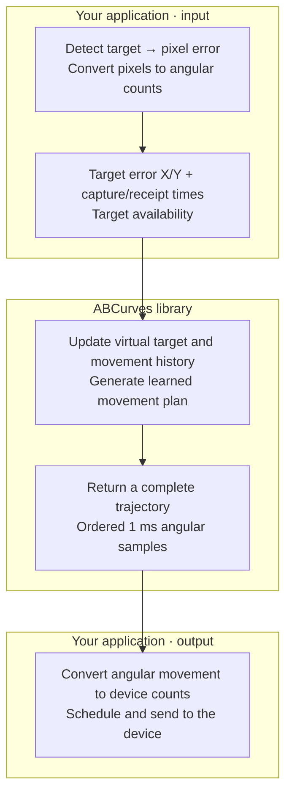

# ABCurves

**Fast, native movement planning powered by learned trajectories.**

ABCurves turns a target's position, expressed as an angular error, into a smooth sequence of movements toward it. This optimized **C++20** implementation generates complete movement commitments [**approximately 2.5–2.9× faster**](#performance) than the original Python implementation in the measured benchmarks.

Available for **C++, C, Python, and Rust**. Your application handles target detection and device output; ABCurves handles trajectory planning.

[Get started](docs/quick-start.md) · [Documentation](docs/README.md) · [Examples](examples/README.md) · [API reference](docs/api/overview.md)

## What is ABCurves?

The library maintains its own virtual movement and target history, accepts timestamped observations, and returns **complete committed segments of 1 ms samples**. Targets can arrive asynchronously. You can start from rest or supply an initial movement prefix, choose a deterministic seed, and optionally use the original C99 Renderer for calibrated integer reports.

The **32 ms, 16 ms, and 8 ms models** describe how long a learned movement commitment lasts. They are independent of camera FPS and device output rate. Already generated movement stays committed; newer observations become eligible at a later decision boundary. Idle segments and existing commitment remainders can be shorter.

## How it works



**You provide:** calibrated X/Y angular error, capture and receipt timestamps in session microseconds, and availability when the target is lost. Model selection happens at startup; prefix, seed, observation policies, and Renderer configuration are optional.

**You receive:** each sample's timestamp, angular displacement during that 1 ms interval, and absolute virtual position. Segment metadata includes duration, actual sample count, selected head and planner mode.

Detection, calibration, output timing and device communication belong to your application. ABCurves needs no capture FPS, physical mouse position, execution feedback or acknowledgments. [Integration guide →](docs/integration.md)

For image-based feedback, consider application-side **capture-latency compensation** to reduce overshoot from stale observations, plus a small **on-target deadband with hysteresis** to reduce unnecessary corrections from detection noise. Capture/receipt timestamps alone do not compensate camera movement. These policies do not cancel already committed movement; see [feedback and on-target stability](docs/integration.md#feedback-latency-and-on-target-stability).

## Performance

**Complete trajectory generation was approximately 2.5–2.9× faster** in the reported benchmarks.

The **original Python reference in `Native/`** already uses Numba/BLAS acceleration. These are warmed medians against the **direct C++ engine in `lib/`**, measured over five runs on a Ryzen 7 5700X3D / Windows x64 with matching weights. The 16/8 ms reference-policy variants were locally trained.

| Operation | Original Python | Optimized C++ | Speedup |
|---|---:|---:|---:|
| Initialization | 918.05 µs | 18.60 µs | 49.36× |
| Fresh decision + first sample | 592.90 µs | 230.20 µs | 2.58× |
| Complete commitment (32 ms) | 665.60 µs | 230.60 µs | **2.89×** |
| Complete commitment (16 ms) | 615.65 µs | 230.10 µs | **2.68×** |
| Complete commitment (8 ms) | 582.70 µs | 228.90 µs | **2.55×** |
| Motor inference alone | 217.00 µs | 203.80 µs | 1.06× |

Initialization, fresh decision, and motor inference rows use the **32 ms model**. Initialization starts with a loaded model and reuses native weights. Complete commitments include a fresh decision and all movement samples; speedup is Python time / C++ time.

Motor inference alone has a smaller gain; most of the overall improvement is outside it. These local results are not hard real-time guarantees. [Model loading, Renderer timing, all function/model measurements, tails and methodology →](docs/guides/performance.md)

## Numerical accuracy

Across **816,000 movement samples in 102 deterministic scenarios**, the original Python implementation and optimized C++ engine produced the same timestamps, commitment boundaries, selected movement heads, and modes.

| Model | Samples compared | Max displacement deviation | Max cumulative-position deviation |
|---|---:|---:|---:|
| 32 ms | 272,000 | 0.00005348 | 0.0006473 |
| 16 ms | 272,000 | 0.00007184 | 0.001374 |
| 8 ms | 272,000 | 0.0001050 | 0.0006812 |

All deviations are per axis in **ABCurves common angular counts**, not device counts. The maximum cumulative-position deviation was **0.001374 common angular counts ≈ 0.0000276° of camera rotation** (about **0.000028°**). Small floating-point differences remain; these tested results do not establish universal mathematical or bitwise identity.

The Renderer matched **144,000/144,000 reports with identical smooth input**. With independently generated planner input, nine reports differed; cumulative movement differed by at most one device count per axis and agreed again within three samples. All tested streams ended with equal totals.

Native binding parity is a separate check, not proof of upstream equality. [Detailed statistics, prefixes, RNG, Renderer differences and reproduction →](docs/guides/numerical-accuracy.md)

## Movement calibration

ABCurves uses a standard **common angular count**:

```text
1 ABCurves count = 0.0003509487083280618 radians ≈ 0.02011 degrees

Input:  pixels → angular error → common angular counts → library
Output: common angular counts → camera angle → device counts → device
```

For image-based calibration, know the game's FOV and full viewport dimensions. With consistent sensitivity/camera settings, send known device counts and measure the resulting camera rotation. For example, **100 device counts / 5° = 20 device counts per degree**. Calibrate X and Y separately.

For a conventional perspective camera, with target error `(dx,dy)` from image center and **Y positive upward**:

```text
angle_x = atan((2 * dx / width)  * tan(HFOV / 2))
angle_y = atan((2 * dy / height) * tan(VFOV / 2))
VFOV    = 2 * atan((height / width) * tan(HFOV / 2))  # If only HFOV is known.

ABCurves input = angle_radians / 0.0003509487083280618
Device counts = movement_counts * 0.0003509487083280618 * (180 / PI)
                * device_counts_per_degree
```

Use radians and the **full game viewport dimensions/FOV, not the cropped detection ROI**; map ROI coordinates back to the full frame first. These formulas give independent horizontal/vertical angular components. For diagonal targets or a non-centered aiming reference, use the game's projection and rotation conventions; see the [calibration guide](docs/guides/calibration.md). At 20 device counts/degree, **100 ABCurves counts ≈ 40.22 device counts**.

FOV/viewport dimensions determine pixel-to-angle conversion; calibrated device counts/degree remain reusable until relevant settings change. Preserve fractional remainders when producing integer reports. Skip this output conversion when the optional Renderer already returns calibrated counts.

## Quick start

Use the Windows x64 DLL and [Python binding](docs/getting-started/python.md), or [build from source](docs/getting-started/building.md):

```python
from abcurves_native import Model, Planner, SegmentController

with Model.embedded(16) as model, Planner(model) as planner:
    with SegmentController(planner) as controller:
        controller.relative((120.0, -7.0), 0, 0)  # Angular error; capture/receipt µs.
        segment = controller.next_segment()
        for sample in segment.samples:
            print(sample.timestamp_us, sample.displacement.x, sample.displacement.y)
        diagnostics = controller.diagnostics
```

This uses simulated time zero. Real observations need one monotonic session clock. A holding decision can return stationary samples. Consume the actual sample count, convert the displacements, and schedule execution independently. Request subsequent segments just before needed; pre-generating too far ahead delays new observations and can lose retained relative-origin references.

## Installation and documentation

**Windows x64 is qualified.** Linux/macOS portability is unverified. Use a locally built runtime SDK or Python wheel, or build from source; no PyPI/crates.io release is claimed. The Python binding uses ctypes and needs no NumPy, Numba or Torch at runtime.

From an MSVC-enabled shell with CMake, build and test:

```powershell
cmake -S . -B build/api -DABC_PROFILE=OFF
cmake --build build/api --config Release --parallel 4
ctest --test-dir build/api -C Release --output-on-failure
```

The DLL is `build/api/Release/abcurves.dll`. Its Windows build embeds all three planner models and the Renderer model. Set `ABCURVES_LIBRARY` to its full path when the binding cannot discover it. External bundles remain available with `Model(path)`. The DLL requires Windows x64 and the appropriate Microsoft Visual C++ runtime. See [runtime packaging](packaging/runtime-readme.md) for DLL-only language workflows.

| Install and run | Integrate and maintain |
|---|---|
| [C++](docs/getting-started/cpp.md) · [C](docs/getting-started/c.md) · [Python](docs/getting-started/python.md) · [Rust](docs/getting-started/rust.md) | [Application integration](docs/integration.md) · [Inputs and outputs](docs/integration.md#what-you-provide) |
| [Runnable examples](examples/README.md) · [Build from source](docs/getting-started/building.md) | [Optional Renderer](docs/advanced/renderer.md) · [Errors and diagnostics](docs/advanced/diagnostics.md) |
| [Packaging](packaging/README.md) · [Troubleshooting](docs/troubleshooting.md) | [API reference](docs/api/overview.md) · [Tests and contributing](CONTRIBUTING.md) |

`lib/` is the engine; `API/` contains language interfaces. `Native/` preserves the Python reference and original Renderer directly as source, with no submodule setup. The current stable C ABI is **1.5**, compatible with 1.4 consumers. [All documentation →](docs/README.md)

## License and credits

Based on [ABCurves by Optima Manent](https://github.com/optima-manent/ABCurves). Software and model assets use the upstream [MIT license](LICENSE); preserve its copyright and license notices. Dataset material and derived examples retain separate CC BY 4.0 attribution. See [NOTICE](NOTICE) and [licensing details](docs/licensing.md).
